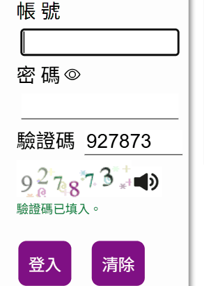

# NTHU Captcha Autofill

[中文](README.md)

Reads and fills in the captcha on the NTHU academic information system and OAuth login pages. It only fills the captcha. It never reads or sends your student ID or password, and it never presses Login for you.

| Academic information system login page | OAuth login page |
|---|---|
|  |  |

## Download

| Device | Download |
|---|---|
| Edge / Chrome | [nthu-captcha-autofill-chrome.zip](https://github.com/gordan12/nthu-oauth-captcha/releases/latest/download/nthu-captcha-autofill-chrome.zip) |
| macOS Safari | [nthu-captcha-autofill-safari.zip](https://github.com/gordan12/nthu-oauth-captcha/releases/latest/download/nthu-captcha-autofill-safari.zip) |
| iPad / iPhone Safari | Install Userscripts first, then open [nthu-oauth-captcha.user.js](https://cdn.jsdelivr.net/gh/gordan12/nthu-oauth-captcha@latest/userscript/nthu-oauth-captcha.user.js) |
| Android Chrome | Nothing to download; add a bookmark (OAuth login page only) |

The links always point to the latest version. Open your device below for the install steps.

The extension's messages on the login page are in Chinese. 「驗證碼已填入」 means the captcha has been filled in.

## Install

<details>
<summary><b>Edge / Chrome</b></summary>

1. Download `nthu-captcha-autofill-chrome.zip`, right-click it and choose **Extract All**. Delete the zip afterwards, so the next update extracts into the same folder.
2. Open `edge://extensions` (`chrome://extensions` in Chrome).
3. Turn on **Developer mode**.
4. Click **Load unpacked** and choose the extracted `nthu-captcha-autofill-chrome` folder.
5. Open the NTHU academic information system or OAuth login page. When 「驗證碼已填入」 appears under the captcha, check your ID and password, then press Login.

**Updating**: download the new zip, extract it the same way and replace the old files, then press the reload icon on this extension in `edge://extensions`. Versions up to 1.0.2 extracted into two nested folders; when updating from those, remove the old extension first and install again with the steps above.

</details>

<details>
<summary><b>macOS Safari</b></summary>

Requires macOS 12 or later.

1. Download `nthu-captcha-autofill-safari.zip`. Safari unzips it into "NTHU Captcha Autofill"; if it is still a zip, double-click it. Drag it into Applications.
2. Open "NTHU Captcha Autofill". macOS says it cannot verify the app is free of malware, because the app is not notarized by Apple. Go to **System Settings → Privacy & Security**, scroll down, click **Open Anyway**, and open the app again. You can close the small window that appears.
3. In Safari, open **Settings → Advanced** and check **Show features for web developers**.
4. In **Settings → Developer**, check **Allow unsigned extensions**.
5. In **Settings → Extensions**, check 「清大驗證碼自動填入」.
6. Open the NTHU academic information system or OAuth login page, click the extension icon next to the address bar, and choose **Always Allow on This Website**. The two login pages are different websites, so allow each once. When 「驗證碼已填入」 appears under the captcha, check your ID and password, then press Login.

Safari turns "Allow unsigned extensions" off every time it quits, so you need to check it again after restarting Safari. To avoid this, use the Userscripts method for iPad / iPhone below; it also works in Safari on the Mac.

**Updating**: drag the new app into Applications, choose Replace, and open the app once.

</details>

<details>
<summary><b>iPad / iPhone Safari</b></summary>

Safari on iPad cannot load extension files directly, so this uses the free Userscripts extension to run the same code.

1. Install "Userscripts" from the App Store, open it once, and choose a folder for scripts when asked.
2. Go to **Settings → Safari → Extensions** (on newer iPadOS, **Settings → Apps → Safari → Extensions**) and turn on Userscripts.
3. Open the `nthu-oauth-captcha.user.js` link from "Download" above in Safari, tap Userscripts in the extensions menu of the address bar, and tap Install.
4. Open the NTHU academic information system or OAuth login page and allow Userscripts when Safari asks. Safari asks once for each of the two login pages. When 「驗證碼已填入」 appears under the captcha, check your ID and password, then press Login.

**Updating**: Userscripts gets new versions from the update URL in the script. To update right away, check for updates on this script in Userscripts.

</details>

<details>
<summary><b>Android Chrome</b></summary>

Chrome on Android cannot install extensions, so this uses a bookmark instead: tap it on the login page and it loads the same code. The first image takes a few seconds.

The bookmark works only on the OAuth login page. The academic information system login page only allows code from its own site, so Chrome blocks the code the bookmark loads and the bookmark only shows a notice. To fill the captcha on that page, use a computer or an iPad.

1. Copy this whole line:

   ```
   javascript:(()=>{const s=document.createElement('script');s.src='https://cdn.jsdelivr.net/gh/gordan12/nthu-oauth-captcha@latest/bookmarklet/nthu-oauth-captcha.js';s.onerror=()=>alert('程式載入失敗。校務資訊系統登入頁不支援書籤，請改用電腦或iPad；其他頁面請檢查網路後再試。');document.body.appendChild(s);})()
   ```

2. Open any page in Chrome and tap **Menu → star** to add a bookmark.
3. Tap **Menu → Bookmarks**, long-press the new bookmark and choose **Edit**. Rename it to something easy to type, such as `nthucaptcha`. Delete the whole URL, paste the line from step 1, and save.
4. Open the OAuth login page, tap the address bar, type `nthucaptcha`, and tap the suggestion with the star. Tapping it from the bookmarks menu does not run it; it has to be from the address bar.
5. When 「驗證碼已填入」 appears under the captcha, check your ID and password, then press Login.

The bookmark does not run by itself; tap it each time you open the login page. On any other page it only shows a notice.

**Updating**: the bookmark loads the latest version every time. Nothing to do.

</details>

## FAQ

<details>
<summary>It filled in the wrong number.</summary>

Press the refresh icon next to the captcha. The extension reads the new image again.

</details>

<details>
<summary>Which pages does it work on?</summary>

Only two login pages:

- The academic information system login page `https://www.ccxp.nthu.edu.tw/ccxp/INQUIRE/`, with a 6-digit captcha. It has no button for a new image, so reload the page if the code is wrong.
- The OAuth login page `https://oauth.ccxp.nthu.edu.tw/v1.1/authorize.php`, with a 4-digit captcha, used by sites such as eeclass and elearn that sign in with an NTHU account.

On Android, the bookmark works only on the OAuth login page.

</details>

<details>
<summary>How do I see which version I have?</summary>

- Edge / Chrome: next to the extension name on the extensions page.
- macOS Safari: open the app, then app name in the menu bar → About.
- iPad / iPhone: the script list in Userscripts.
- Android: the bookmark always runs the latest version.

</details>

<details>
<summary>How do I use an older version?</summary>

- Edge / Chrome, macOS Safari: find that version on [Releases](https://github.com/gordan12/nthu-oauth-captcha/releases) and download its zip. Do not pick **Source code (zip)** at the bottom; that is the whole source, not the extension.
- iPad / iPhone: replace `@latest` in the install URL with a version (for example `@v1.0.3`), install it, and turn off updates for this script in Userscripts.
- Android: replace `@latest` in the bookmark URL with a version.

</details>

<details>
<summary>Does it need the internet? Where does my data go?</summary>

Recognition runs in your own browser, and the captcha image is never sent to any server. The Edge / Chrome and macOS Safari versions carry the model inside the extension and work fully offline. The iPad and Android versions download the recognition code and model from jsDelivr.

</details>

## Credits and license

The captcha models were not trained in this repo. The weights for both login pages, and the code that runs them, come from [Hsiii/ccxpLite](https://github.com/Hsiii/ccxpLite) and [Hsiii/ccxpDecaptcha](https://github.com/Hsiii/ccxpDecaptcha) (Copyright 2022 25349023, Copyright 2026 Hsi), under the MIT License; the full text is in [MIT-ccxpLite.txt](MIT-ccxpLite.txt).

Versions 1.0.x used the OAuth model from [justin0u0/NTHU-OAuth-Decaptcha](https://github.com/justin0u0/NTHU-OAuth-Decaptcha) (Copyright 2022 Justin Chen, Bronwin Chen, Apache License 2.0).

To change the code or publish a release, see the [development notes](docs/development.md) (in Chinese).
