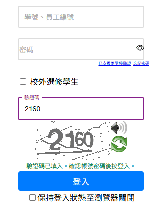

# 清大 OAuth 驗證碼自動填入

[English](README.en.md)

打開清大 OAuth 登入頁時，自動辨識並填入驗證碼。只填驗證碼，不會讀取或送出帳號密碼，也不會代按登入。



## 下載

| 裝置 | 下載 |
|---|---|
| Edge / Chrome | [nthu-oauth-captcha-chrome.zip](https://github.com/gordan12/nthu-oauth-captcha/releases/latest/download/nthu-oauth-captcha-chrome.zip) |
| macOS Safari | [nthu-oauth-captcha-safari.zip](https://github.com/gordan12/nthu-oauth-captcha/releases/latest/download/nthu-oauth-captcha-safari.zip) |
| iPad / iPhone Safari | 先裝 Userscripts，再打開 [nthu-oauth-captcha.user.js](https://cdn.jsdelivr.net/gh/gordan12/nthu-oauth-captcha@latest/userscript/nthu-oauth-captcha.user.js) |
| Android Chrome | 不用下載，新增一個書籤 |

連結永遠指向最新版。點開下面你的裝置看安裝步驟。

## 安裝

<details>
<summary><b>Edge / Chrome</b></summary>

1. 下載 `nthu-oauth-captcha-chrome.zip`，按右鍵選**全部解壓縮**。解壓後把 zip 刪掉，下次更新才會解壓到同一個資料夾。
2. 打開 `edge://extensions`（Chrome 則是 `chrome://extensions`）。
3. 打開**開發人員模式**。
4. 按**載入未封裝**，選解壓出來的 `nthu-oauth-captcha-chrome` 資料夾。
5. 打開清大 OAuth 登入頁。驗證碼下方出現「驗證碼已填入」後，確認帳號密碼，再按登入。

**更新**：下載新版 zip，同樣全部解壓縮並取代舊檔案，再到 `edge://extensions` 按這個外掛的重新載入圖示。1.0.2 以前的版本解壓後有兩層資料夾，從那些版本更新時，先移除舊的外掛，再照上面的步驟裝一次。

</details>

<details>
<summary><b>macOS Safari</b></summary>

需要 macOS 12 以上。

1. 下載 `nthu-oauth-captcha-safari.zip`。用 Safari 下載會自動解開成「NTHU OAuth Captcha」；若還是 zip，雙擊就會解開。把它拖進「應用程式」。
2. 打開「NTHU OAuth Captcha」。macOS 會說無法確認是否含有惡意軟體，因為這個 App 沒有經過 Apple 公證。到**系統設定 → 隱私權與安全性**，往下按**仍要打開**，再打開一次。跳出的小視窗可以關掉。
3. Safari 打開**設定 → 進階**，勾選**顯示網頁開發者功能**。
4. 在**設定 → 開發者**勾選**允許未簽署的延伸功能**。
5. 在**設定 → 延伸功能**勾選「清大 OAuth 驗證碼自動填入」。
6. 打開清大 OAuth 登入頁，按網址列旁的外掛圖示，選**在此網站上一律允許**。驗證碼下方出現「驗證碼已填入」後，確認帳號密碼，再按登入。

「允許未簽署的延伸功能」在 Safari 每次結束後會自動取消，重開 Safari 後要再勾一次。要免掉這一步，可以改用下面 iPad / iPhone 的 Userscripts 做法，Mac 的 Safari 也適用。

**更新**：把新版拖進「應用程式」，選取代，再打開 App 一次。

</details>

<details>
<summary><b>iPad / iPhone Safari</b></summary>

iPad 的 Safari 不能直接載入外掛檔案，這裡改用免費的 Userscripts 外掛執行同一份程式。

1. 從 App Store 安裝「Userscripts」，打開一次，照指示選一個存放腳本的資料夾。
2. 到**設定 → Safari → 延伸功能**（較新的 iPadOS 在**設定 → App → Safari → 延伸功能**），打開 Userscripts。
3. 用 Safari 打開上面「下載」裡的 `nthu-oauth-captcha.user.js` 連結，從網址列的延伸功能選單點 Userscripts，按安裝。
4. 打開清大 OAuth 登入頁，Safari 問 Userscripts 的權限時選允許。驗證碼下方出現「驗證碼已填入」後，確認帳號密碼，再按登入。

**更新**：Userscripts 會照腳本裡的更新網址取得新版。想馬上更新，在 Userscripts 裡對這個腳本檢查更新。

</details>

<details>
<summary><b>Android Chrome</b></summary>

Android 的 Chrome 不能裝外掛，這裡改用書籤：在登入頁點書籤，書籤會載入同一份程式。第一張圖要等幾秒。

1. 複製下面整行：

   ```
   javascript:(()=>{const s=document.createElement('script');s.src='https://cdn.jsdelivr.net/gh/gordan12/nthu-oauth-captcha@latest/bookmarklet/nthu-oauth-captcha.js';document.body.appendChild(s);})()
   ```

2. 在 Chrome 隨便打開一個網頁，按右上角**選單 → 星號**加入書籤。
3. 按**選單 → 書籤**，找到剛剛那個書籤，長按後選**編輯**。名稱改成好打的字，例如 `nthucaptcha`；網址整個刪掉，貼上第 1 步複製的那行，存檔。
4. 打開清大 OAuth 登入頁，點網址列，輸入 `nthucaptcha`，點建議清單裡有星號的那一項。從書籤選單直接點不會執行，一定要從網址列點。
5. 驗證碼下方出現「驗證碼已填入」後，確認帳號密碼，再按登入。

書籤不會自己執行，每次打開登入頁都要點一次。在別的網頁點，只會跳出提示。

**更新**：每次點書籤都會載入最新版，不用做任何事。

</details>

## 常見問題

<details>
<summary>填錯了怎麼辦？</summary>

按驗證碼旁邊的重新整理圖示，外掛會換一張再辨識。

</details>

<details>
<summary>哪些頁面會用到？</summary>

只作用於 `https://oauth.ccxp.nthu.edu.tw/v1.1/authorize.php`，例如 eeclass、elearn 這類用清大帳號登入的網站。校務系統首頁 `www.ccxp.nthu.edu.tw` 的 6 位數驗證碼不在範圍內。

</details>

<details>
<summary>怎麼看自己裝的是哪一版？</summary>

- Edge / Chrome：擴充功能頁的外掛名稱旁邊。
- macOS Safari：打開 App，選單列的 App 名稱 → 關於。
- iPad / iPhone：Userscripts 的腳本清單。
- Android：書籤永遠是最新版。

</details>

<details>
<summary>想用舊版怎麼辦？</summary>

- Edge / Chrome、macOS Safari：到 [Releases](https://github.com/gordan12/nthu-oauth-captcha/releases) 找那一版，下載它附的 zip。不要選最底下的 **Source code (zip)**，那是整個原始碼，不是外掛。
- iPad / iPhone：把安裝網址裡的 `@latest` 改成版本號（例如 `@v1.0.3`）再安裝，並在 Userscripts 關掉這個腳本的更新。
- Android：把書籤網址裡的 `@latest` 改成版本號。

</details>

<details>
<summary>需要連網嗎？資料會送到哪裡？</summary>

辨識都在你自己的瀏覽器裡算，驗證碼圖片不會送到任何伺服器。Edge / Chrome 和 macOS Safari 版把模型裝在外掛裡，完全不用連網。iPad 和 Android 版會從 jsDelivr 下載辨識程式和模型。

</details>

## 來源與授權

驗證碼辨識模型不是這個 repo 訓練的。模型權重和執行它的程式來自 [Hsiii/ccxpLite](https://github.com/Hsiii/ccxpLite) 與 [Hsiii/ccxpDecaptcha](https://github.com/Hsiii/ccxpDecaptcha)（Copyright 2022 25349023, Copyright 2026 Hsi），採用 MIT License，全文在 [MIT-ccxpLite.txt](MIT-ccxpLite.txt)。

1.0.x 版的 OAuth 模型來自 [justin0u0/NTHU-OAuth-Decaptcha](https://github.com/justin0u0/NTHU-OAuth-Decaptcha)（Copyright 2022 Justin Chen, Bronwin Chen，Apache License 2.0）。

想修改或發佈新版，請看[開發說明](docs/development.md)。
